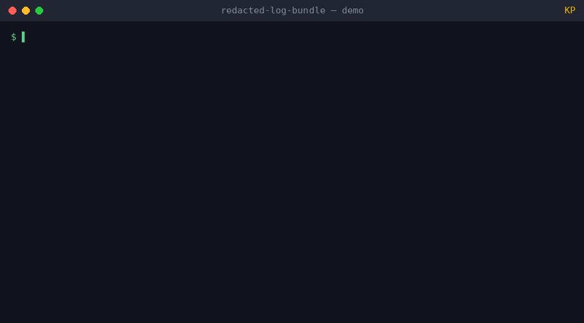
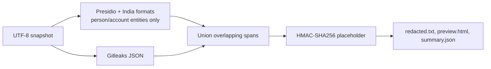

# Redacted Log Bundle


Built by Kanak Prabhakar

Share a support log without leaking personal data or secrets, and still be able to follow one user or one token across lines. Every sensitive value becomes a keyed placeholder like `[R-b44a…]`. The same value always becomes the same placeholder, so joins and searches keep working.



The demo shows real output. The e-mail on line 1 and line 4 gets the same token, and the timestamps stay readable.

## Install and use
Use a Python 3.11+ virtual environment. Run `python setup_project.py` once. It downloads the English spaCy model and the Gitleaks 8.30.1 binary, checking the archive's SHA-256 first. After that, everything runs offline.

```sh
python bundle.py support.log bundle-out private.key
```

- `bundle-out/` must not exist yet. It gets `redacted.txt`, `summary.json` (counts per detector label) and `preview.html` (escaped, safe to open).
- `private.key` is created on first use (32 random bytes). Keep it private. Reusing it links the same values across runs. Use a fresh key for each unrelated recipient.
- You don't need to activate the venv. `bundle.py` finds the Gitleaks binary that setup installed next to the interpreter.

## How it works


- The bundle asks Presidio only for entities that identify a person or an account: e-mail, phone, person name, IP, MAC, card, IBAN, crypto wallet, Aadhaar-format, PAN-format and Indian phone.
- `DATE_TIME`, `URL`, `ORGANIZATION` and the US-only number types are left out on purpose. On log lines they masked every timestamp and swallowed neighbouring fields.
- A `key=` prefix is trimmed from e-mail spans, so `user=a@b.com` and a bare `a@b.com` get the same token.
- Overlapping spans are merged before replacement, so no partial value can leak.
- Output is staged in a temporary folder and only renamed into place once every file is written. If a detector fails, nothing is published.

## Benchmark
Run `python -m pytest -q` (7 tests, including a real subprocess run with spaCy and Gitleaks) and `python bench.py`. Raw numbers are in `results.jsonl`.

**Suite 1, single values.** Twelve synthetic values per category, each written twice, plus 24 benign control lines. Recall means the whole line was replaced. A pair is preserved when both copies became the same placeholder.

| Detector | Phone | Aadhaar-format | PAN-format | Token | E-mail (example.com) | E-mail (internal suffix) | Benign lines changed / 24 | Preserved pairs / 72 |
|---|---:|---:|---:|---:|---:|---:|---:|---:|
| Stock Presidio | 100% | 83.3% | 16.7% | 16.7% | 100% | 0% | 2 | 38 |
| Stock Gitleaks | 0% | 0% | 0% | 100% | 0% | 0% | 0 | 12 |
| **Bundle** | **100%** | **100%** | **100%** | **100%** | **100%** | **100%** | **0** | **72** |

The previous fixture used only `@example.invalid` addresses. Stock Presidio rejects that TLD, which made it score 0% on e-mail. That was not a fair test. The suite now has a public-TLD column (`example.com`, reserved by RFC 2606) where stock Presidio scores 100%. A separate column covers internal suffixes such as `.invalid`, `.local` and `.corp`, which are common in support logs. Stock Presidio misses those, and the bundle's mailbox pattern is built for them.

**Suite 2, realistic log lines.** 24 lines. Each line has a timestamp, a level, and an e-mail, phone, PAN, Aadhaar and IP field, with values repeating across lines. "Exact token" means the value became exactly the placeholder for that value alone, with no neighbour glued on, so joins work.

| Detector | Values hidden (e-mail / phone / PAN / Aadhaar / IP) | Exact token (same order) | Timestamps kept |
|---|---|---|---:|
| Stock Presidio | 100 / 100 / 37.5 / 100 / 100 % | 0 / 100 / 29.2 / 0 / 100 % | 0 / 24 |
| Stock Gitleaks | 0 % across all | 0 % across all | 24 / 24 |
| **Bundle** | **100 % across all** | **100 % across all** | **24 / 24** |

All results come from these synthetic fixtures. No real person's data is used, and no reviewer-time metric is collected.

## Limitations and roadmap
- The India patterns detect formats, not issued numbers. They can mask an ordinary 12-digit number and miss spelling or punctuation variants.
- The spaCy person-name model is small. Names in unusual casing can be missed, and spans holding digits or `key=value` text are rejected as names.
- A low-entropy fake token (for example `ghp_0123…abc`) is ignored by Gitleaks's entropy check. Real tokens are random and are caught.
- Input and the English model must fit in RAM. The temporary scanner report holds raw findings until cleanup.
- Next: multi-language names, and secret families beyond Gitleaks's bundled rules.

## Resume line
Accomplished shareable support logs that keep 72/72 repeated values joinable and 24/24 timestamps readable on realistic mixed-field lines (stock Presidio: 38/72 pairs, 0/24 timestamps), as measured by `bench.py`'s two synthetic suites, by doing span reconciliation across Presidio, India-format rules and Gitleaks with keyed HMAC pseudonymization.

## Credits
[Microsoft Presidio](https://github.com/microsoft/presidio) (MIT), [Gitleaks](https://github.com/gitleaks/gitleaks) (MIT), [spaCy and English models](https://spacy.io/models/en) (MIT), [pytest](https://pytest.org/) (MIT).

## Presentation
1. I defined the local sharing workflow in PRD.md.
2. I combined Presidio, India-format rules and Gitleaks in bundle.py.
3. I hashed each value with a private key and merged overlapping spans before replacement.
4. I added a realistic mixed-line benchmark. It exposed timestamp masking and broken e-mail joins, which I fixed by restricting entities and trimming `key=` prefixes.
5. I exercised the complete CLI in test_integration.py and measured everything in bench.py.

**Main limitation.** A missed detection can still expose data, and format rules can mask ordinary numbers.

See PRD.md, TRD.md and edge-cases.md for the design, and tests-output.txt for the latest pytest run.
