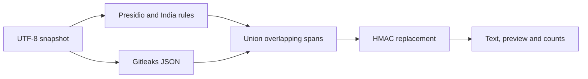

# Redacted Log Bundle


Built by Kanak Prabhakar

Support engineers can preview and share a local UTF-8 text bundle while retaining exact-value joins. The summary counts merged replacements by detector label. Demo GIF placeholder: `assets/demo.gif`.

## Install and use
Use an activated Python 3.11+ environment with compatible spaCy wheels. Run `python setup_project.py`. Setup downloads the English model and verifies the Gitleaks 8.30.1 archive checksum. Analysis subsequently runs locally.

Run `python bundle.py support.log bundle-out private.key` from the extracted directory. Use a new output directory and keep the key in private storage. Review bundle-out/preview.html locally before sharing. A reused key links identical byte representations across runs. Protect its directory with account-only permissions on Windows. Use a fresh key for unrelated recipients.

## Architecture


## Tests and benchmark
Run `python -m pytest -q`. Cases cover partial overlaps, invalid spans, empty input, Unicode joins, key rotation, format matches and boundaries. Run `python bench.py` for the detector integration benchmark. Its deterministic corpus repeats twelve synthetic values per sensitive category and twelve benign controls twice. Each baseline uses the same replacement algorithm. Recall requires complete replacement of a labeled line. False redactions count altered benign lines. Join preservation requires both copies to become identical placeholders. Results apply to these fixtures. No reviewer-time metric is collected.

| Detector | Phone recall | Aadhaar-format | PAN-format | Synthetic token | Email | False redactions / 24 | Preserved pairs / 60 |
|---|---:|---:|---:|---:|---:|---:|---:|
| Presidio | 100.0% | 83.3% | 16.7% | 16.7% | 0.0% | 2 | 26 |
| Gitleaks | 0.0% | 0.0% | 0.0% | 100.0% | 0.0% | 0 | 12 |
| Bundle | 100.0% | 100.0% | 100.0% | 100.0% | 100.0% | 2 | 60 |

## Limitations and roadmap
India patterns detect formats. They can match ordinary numbers and miss spelling or punctuation variants. Exact joins depend on consistent span boundaries. Input and the English model must fit in RAM. The temporary scanner report contains raw findings until cleanup. Expand evaluation to mixed-field lines, ambiguous numbers and additional secret families.

## Resume
Accomplished exact-value correlation after masking as measured by TBD of 60 preserved synthetic pairs by doing span reconciliation and keyed pseudonymization. Run bench.py and use the Bundle preserved_pairs field.

Tests include a subprocess integration with the local spaCy model and native Gitleaks executable.

## Credits
[Microsoft Presidio](https://github.com/microsoft/presidio), [Gitleaks](https://github.com/gitleaks/gitleaks), [spaCy and English models](https://spacy.io/models/en), [pytest](https://pytest.org/).


## Publish
Run from the extracted project directory with GitHub CLI authenticated.
```sh
git init -b main && git add . && git -c user.name="Kanak Prabhakar" -c user.email="kanakprabhakar72@gmail.com" commit -m "Add Redacted Log Bundle" && gh repo create Kanak234/redacted-log-bundle --public --source=. --remote=origin --push
```

## Presentation

1. I defined the local sharing workflow in PRD.md.
2. I combined Presidio, India-format rules and Gitleaks in bundle.py.
3. I used a keyed digest for repeated values and merged overlapping spans before replacement.
4. I exercised the complete CLI in test_integration.py.
5. I measured category recall, false redactions and join preservation in bench.py.

**Main limitation.** Missed detections can expose data, and format rules can mask ordinary values.


See edge-cases.md for tested inputs and tests-output.txt for actual Windows pytest output.
